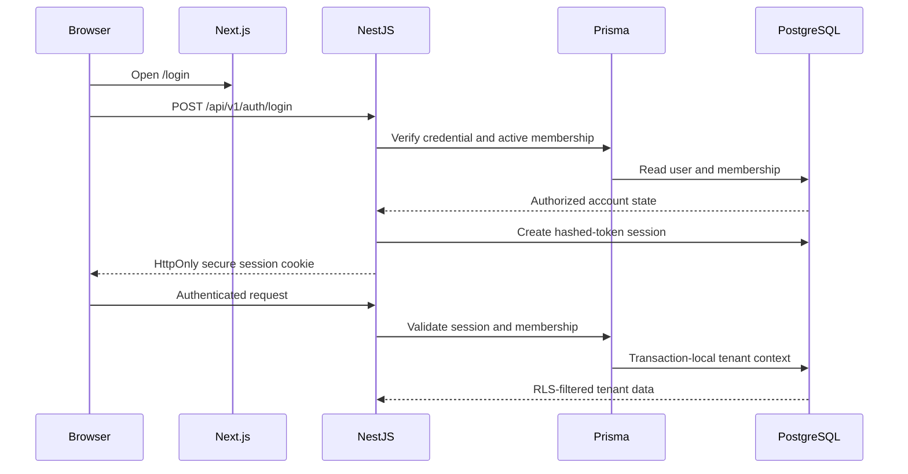

# Authentication

The platform uses opaque server-side sessions rather than JWTs. A 256-bit random token is returned only in an HttpOnly cookie. PostgreSQL stores SHA-256 of the token, never the raw token.

Passwords use Argon2id with a unique salt managed by the argon2 library. Password hashes are stored in `password_credentials` and excluded from public user responses.

The login flow:

1. Normalize and validate email and password.
2. Look up the user and password credential.
3. Reject inactive, disabled, deleted, or credential-less users.
4. Verify Argon2id password.
5. Check active tenant memberships.
6. Create a persisted session.
7. Set an HttpOnly cookie.

Logout revokes only the presented session and clears the cookie. Session expiration and revocation are enforced by `AuthGuard`.

